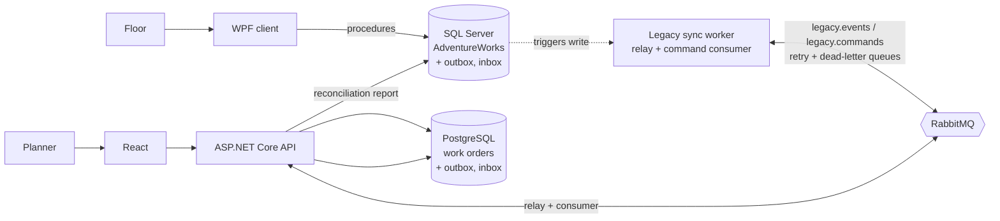
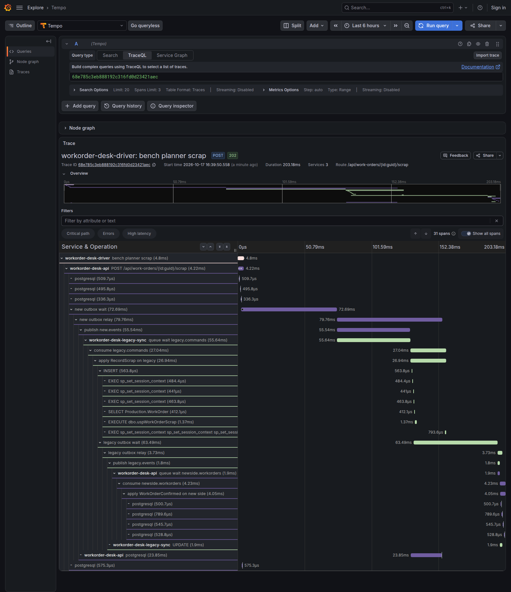
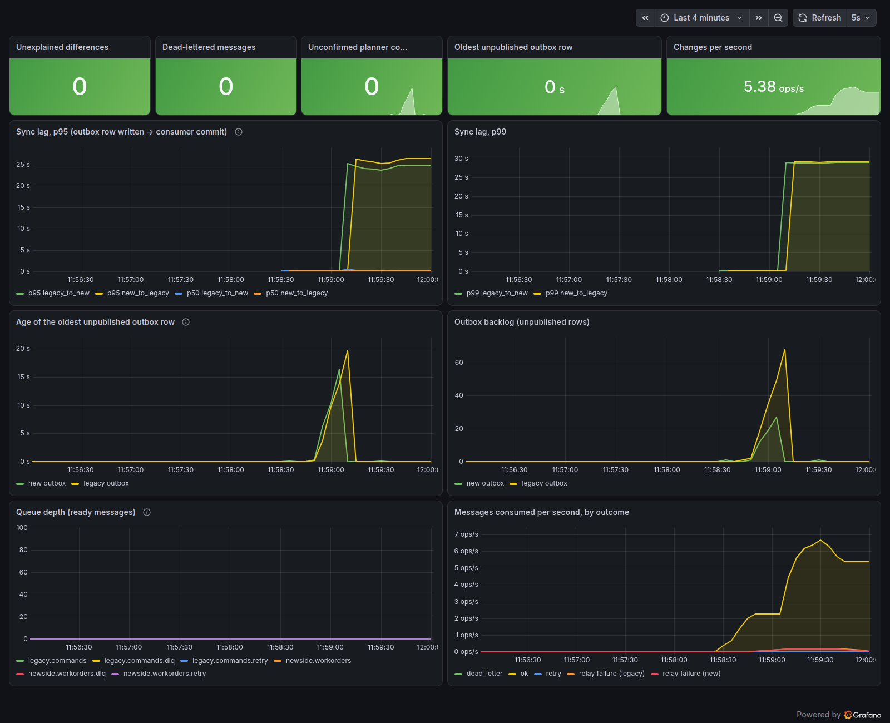

# workorder-desk-modernization

One role of a legacy desktop system moves to the web while the old system stays in use. A work-order desk, a **WPF client on SQL Server**, is
rebuilt as **React, an ASP.NET Core API and PostgreSQL**; both run at once on the same work orders, synchronised both ways through an
outbox on each side and RabbitMQ, traced end to end with OpenTelemetry. It runs locally with Docker Compose.



*Planner and floor write the same orders at the same time. Each side's change and its outbox row commit together; the other side applies
it idempotently, and a reconciliation report compares every field of every order.*

## What it shows

| Question | Answer, with where it is checked |
|---|---|
| How long does a change take to cross? | Median about **110 ms** with the relay polling every 200 ms, **34 ms** at 50 ms (`make bench`, 10 changes a second for 30 s, 0 errors) |
| What happens when the broker is down? | A 15 s outage delayed changes by up to **22 s**; nothing was lost or duplicated (`make bench ARGS="--rate 5 --seconds 60 --api-share 0.3 --outage-at 15 --outage-for 15"`) |
| What if both sides edit the same order? | One rule per kind of field, every conflict logged on the side that resolved it: [conflicts-and-reconciliation.md](docs/current/conflicts-and-reconciliation.md) |
| What if a message cannot be applied? | Retried, then dead-lettered, then visible in the reconciliation report and re-driven after the fix: [failure-cases.md](docs/current/failure-cases.md) |
| What did the old database hide? | Microsoft's `uWorkOrder` trigger cannot change an order's quantity at all (error 515, reported as 3609). Found when the first quantity change dead-lettered |
| Can a person be erased from both systems and the broker? | Yes, and a scan proves nothing is left: [erasure.md](docs/current/erasure.md) |
| Can I see one change cross every hop? | One trace from the client or the API through both outboxes, the broker and both databases: [observability.md](docs/current/observability.md) |





All diagrams and screenshots, and how each was made: [docs/current/evidence/](docs/current/evidence/README.md).

It moves one role (the planner's work-order desk), on Microsoft's AdventureWorks sample database, whose people are fictional
([THIRD-PARTY-NOTICES.md](THIRD-PARTY-NOTICES.md)). The figures come from one run per scenario on one machine: they show the
shape of the behaviour, not a benchmark of the broker.

## Run it

You need Docker with Compose, Python 3, Node.js, and about 2 GB of free RAM for SQL Server. The first `docker compose` run pulls about 1.5 GB.

```bash
# Microsoft's .NET 10 SDK, user-local (the Makefile expects ~/.dotnet-sdk10; global.json pins 10.0.401)
curl -sSL https://dot.net/v1/dotnet-install.sh | bash -s -- --channel 10.0 --install-dir ~/.dotnet-sdk10

make up       # writes .env with random passwords, downloads AdventureWorks (checksum pinned), starts SQL Server, PostgreSQL,
              # RabbitMQ and Grafana, restores the database and applies this repository's scripts
make import   # EF Core migrations, then the one-off import of the legacy orders into PostgreSQL
make api      # builds React and serves it with the API on http://127.0.0.1:32130
make relay    # in a second terminal: the legacy side's outbox relay and command consumer
```

Then, from another terminal:

```bash
make smoke          # create, release, record, scrap and close one work order through the legacy procedures; it reaches PostgreSQL
make trace-check    # one desktop edit and one planner edit, each fetched back from Tempo with every hop present
make bench          # lag percentiles read from the databases; add ARGS="..." as above for an outage
make simulate       # synthetic background activity (whole order lifecycles) until Ctrl+C; clearly labelled synthetic
make reconcile      # compare both sides per order; exits 1 if anything is unexplained
make test           # 52 tests, a few minutes; starts its own SQL Server, PostgreSQL and RabbitMQ
```

Grafana is on http://127.0.0.1:32134 (the "Work-order sync" dashboard) and the RabbitMQ UI on http://127.0.0.1:32133 (user `lab`, password in `.env`).
Ports used: 32130 to 32136, all bound to loopback (SQL Server and the collector also to the libvirt bridge, for the VM).

The real WPF client needs a Windows machine: it runs here in a Windows Server 2012 R2 VM, set up as described in
[docs/current/windows-vm.md](docs/current/windows-vm.md). It is optional; `make bench` and `make simulate` drive the same stored procedures the client calls.

## Where things are

| Path | What |
|---|---|
| `legacy/sql/` | This repository's scripts on top of AdventureWorks: procedures, the outbox and inbox, conflict log (numbered, applied once each) |
| `legacy/wpf/` | The WPF client (.NET Framework 4.8), built on Linux |
| `src/WorkOrders.Api/`, `src/WorkOrders.Web/` | The new side: ASP.NET Core API (EF Core, PostgreSQL) and the React planner desk |
| `src/Sync.*` | Message contracts, the RabbitMQ bus, and the legacy relay and command consumer |
| `src/Lab.Driver/` | `edit`, `bench` and `simulate`: drives the stored procedures and the API |
| `observability/`, `docker-compose.yml` | The dashboard and the containers |
| `tests/Sync.Tests/` | Tests against real SQL Server, PostgreSQL and RabbitMQ: duplicate delivery, out of order, both sides edited, broker down, a consumer that dies, a poison message, a trigger that rolls back, a user on the desktop mid-migration |
| `docs/current/` | Architecture notes, runbook, verification (every figure with its command), evidence |

## Licence

MIT for this repository's code ([LICENSE](LICENSE)). The database it runs on is Microsoft's sample, under its own MIT notice
([THIRD-PARTY-NOTICES.md](THIRD-PARTY-NOTICES.md)); the backup is downloaded, never committed.

---

**Daniel Colaço**, Software Architect: diagnosis, modernization and performance · [danielcolaco.pt](https://danielcolaco.pt/en/)

Written up in [Replacing a live system one role at a time](https://danielcolaco.pt/en/articles/replacing-a-live-system/)
